# DevOps Dashboard

**A self-hosted dashboard for server telemetry, Docker and Kubernetes inventory, monitoring, and user-initiated AI-assisted operations.**

[Türkçe](#türkçe) · [English](#english)

<p align="center">
  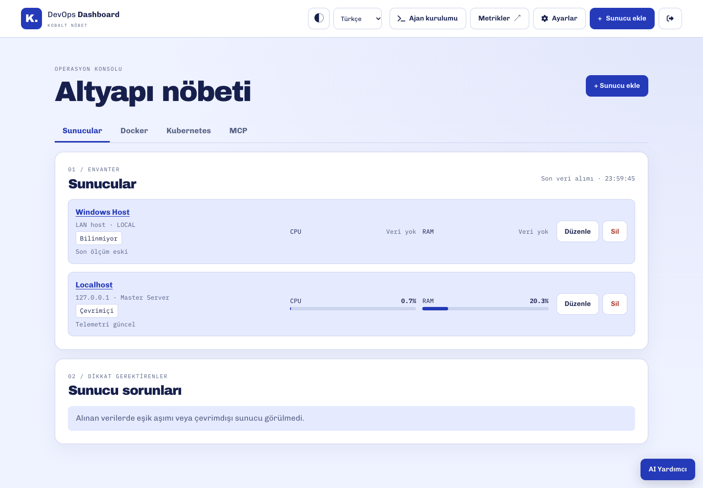
</p>

Türkçe ve İngilizce arayüzlerin ayrıntılı ekran görüntüleri: [Türkçe galeri](#ekran-görüntüleri) · [English gallery](#screenshots)

## Türkçe

DevOps Dashboard; yerel veya uzak sunucuları, ajanlardan gelen telemetriyi, Docker konteynerlerini ve Kubernetes podlarını tek panelde takip etmek için self-hosted bir uygulamadır. İsteğe bağlı AI sohbeti, seçili sunucu bağlamıyla analiz yapabilir. Basit istekler tek ajanla, karmaşık teşhisler gerektiğinde 2–3 CrewAI ajanıyla işlenir.

### Özellikler

- Sunucu listesi, çevrimiçi/çevrimdışı/bilinmiyor durumu, CPU/RAM/disk metrikleri ve geçmiş verileri
- Linux sunucular için Docker telemetrisi; Kubernetes pod görünümü
- Windows için PowerShell telemetri betiği ve SSH erişilebilirliğine dayalı ikincil durum kontrolü
- Kullanıcı isteğiyle başlatılan, seçili sunucu bağlamlı AI sohbeti; yerel, bulut ve CrewAI sağlayıcıları
- CrewAI/LangGraph sorgu yönlendirmesi: basit sorularda tek ajan, gerekli olduğunda çoklu ajan
- Prometheus metrik endpoint'i ve isteğe bağlı Grafana/Prometheus Compose profili
- Sunucu detayları, canlı telemetri, görev kuyruğu ve ayarlanabilir Telegram bildirimleri
- Türkçe varsayılan arayüz, İngilizce seçeneği ve açık/koyu tema
- MCP sunucusu ile uyumlu istemcilere dashboard araçlarını sunma

> Sunucu durum göstergesi telemetri tazeliğini ve bazı kontrolleri kullanır; yalnızca ping/HTTP yanıtı değildir. Windows'ta SSH portunun erişilebilir olması tek başına telemetri alındığı anlamına gelmez. Uzak sunucular kendiliğinden keşfedilmez; sunucuyu kaydedip uygun ajanı yapılandırmanız gerekir.

### Ekran Görüntüleri

Görüntüler çalışan yerel panelden alınmıştır. Yerel ağ adresleri ve makine adları gizlilik için anonimleştirilmiştir.

| Genel bakış ve sunucu envanteri | Docker konteynerleri |
|---|---|
| 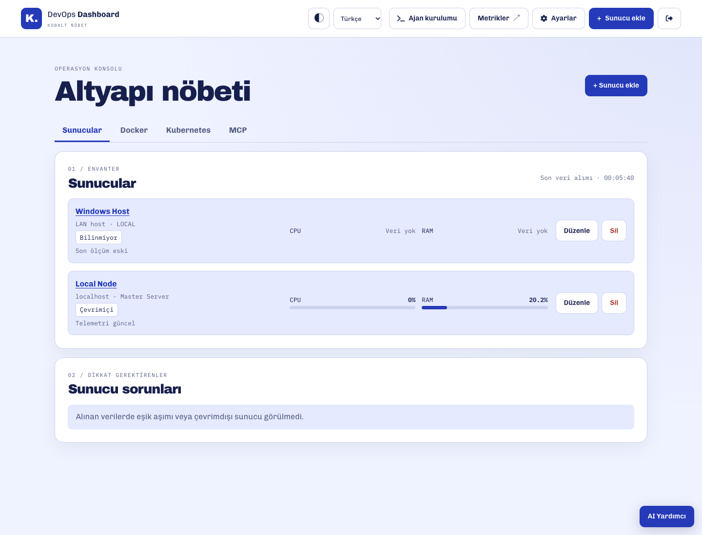 | 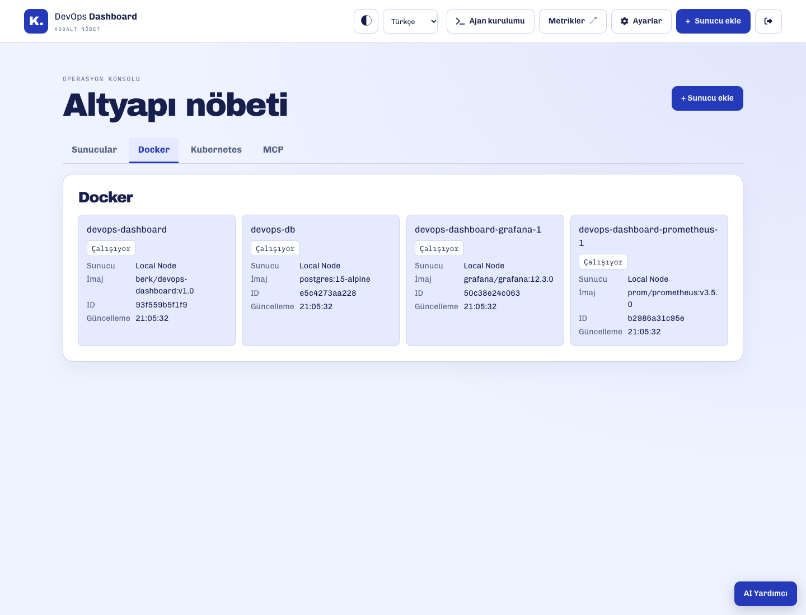 |

| Kubernetes pod görünümü | MCP araçları |
|---|---|
| 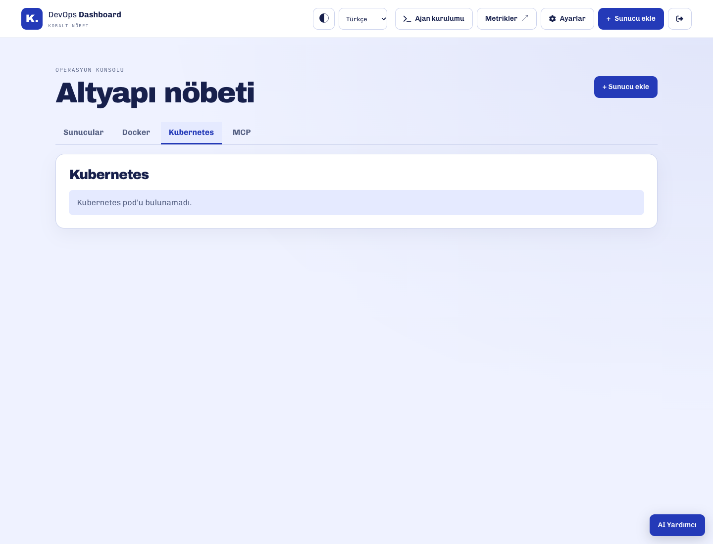 | 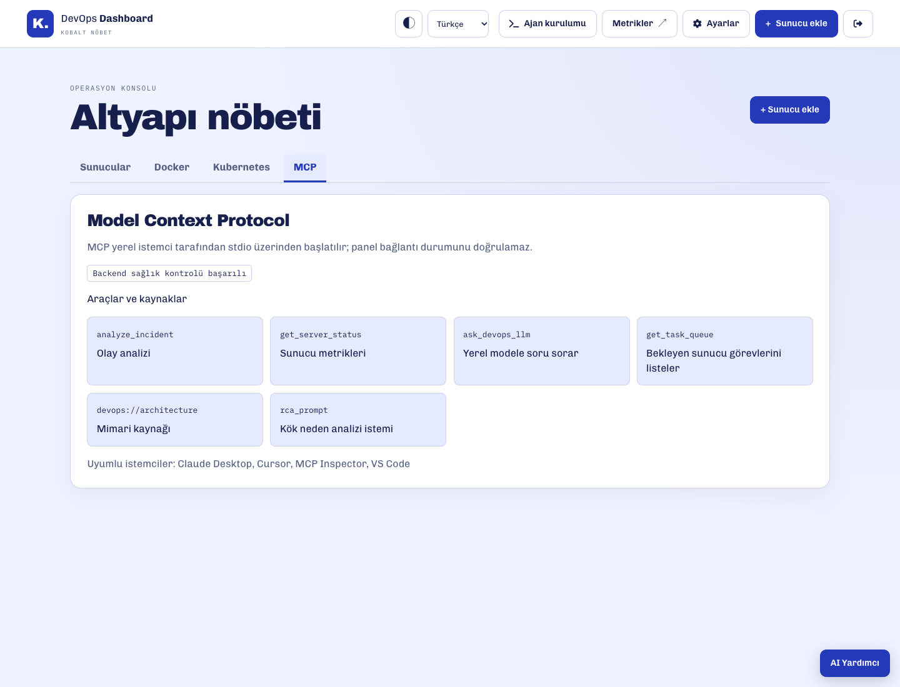 |

| Sunucu detayı ve telemetri | Seçili sunucu bağlamlı AI sohbeti |
|---|---|
| 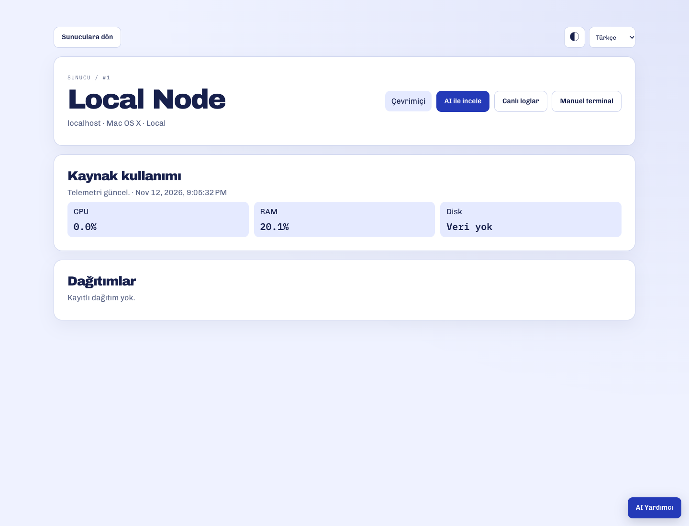 | 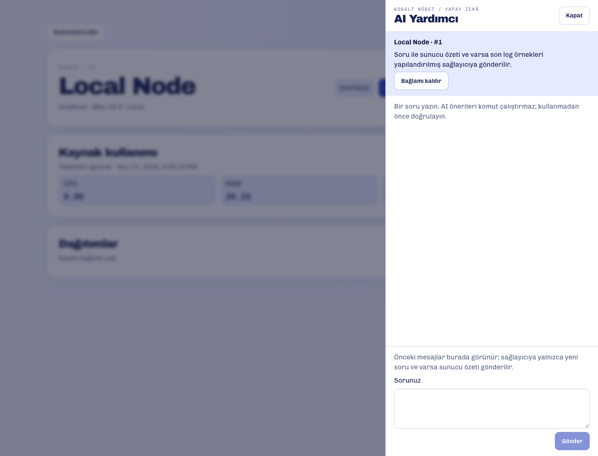 |

| Yapılandırma ayarları | Prometheus hedef sağlığı |
|---|---|
| 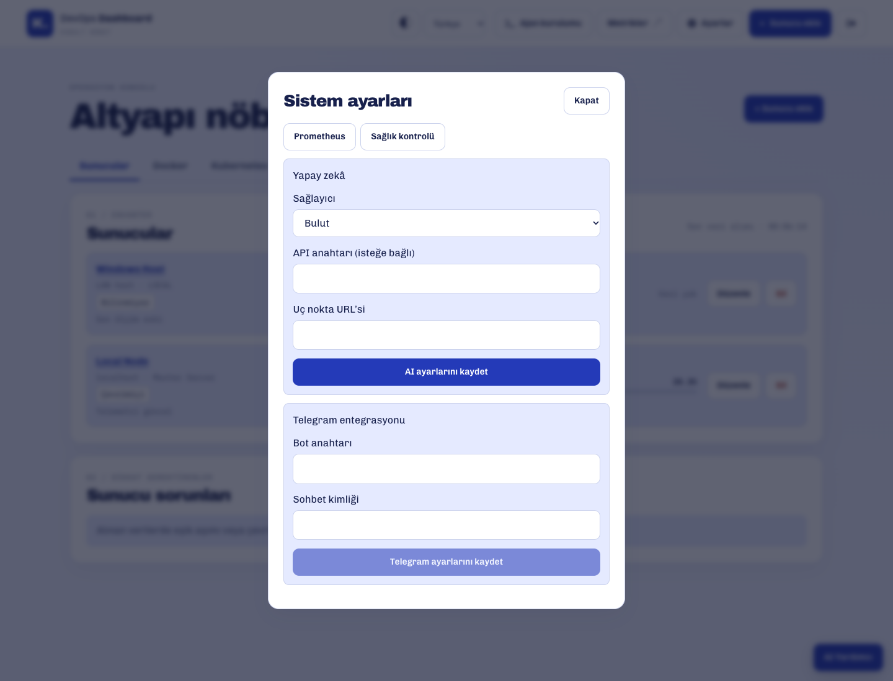 | 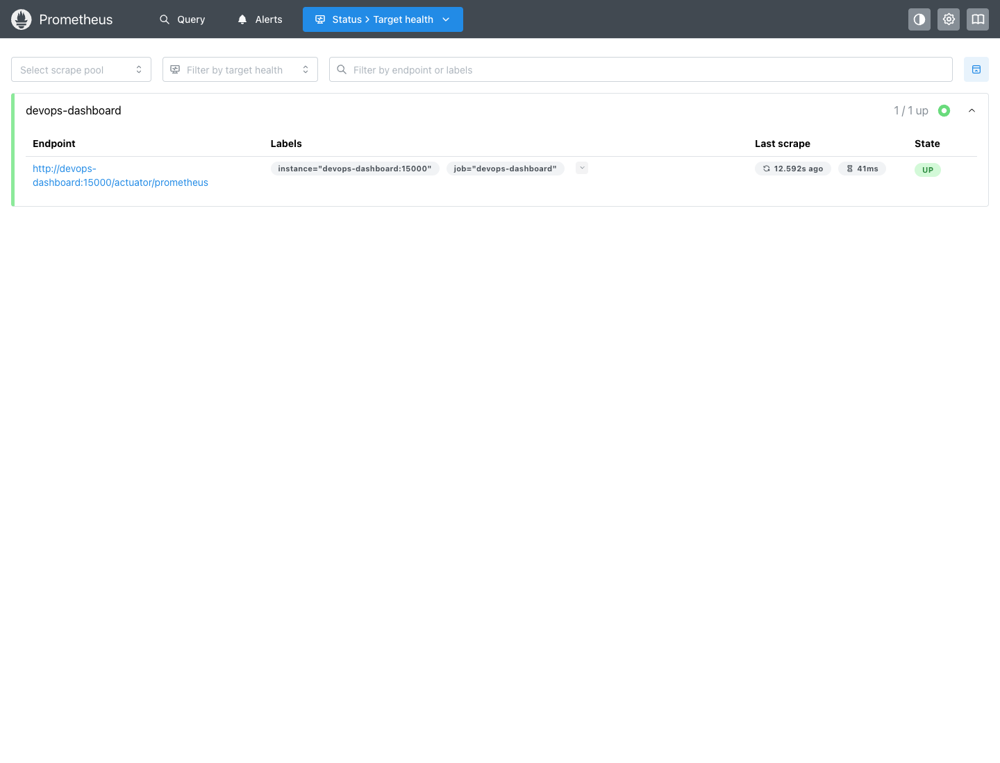 |

### Hızlı Başlangıç

Gereksinimler: Docker ve Docker Compose. Dashboard ile PostgreSQL'i başlatın:

```bash
docker compose up -d --build
```

Panel: [http://localhost:15000](http://localhost:15000)

Prometheus ve Grafana'yı da başlatmak için:

```bash
docker compose --profile monitoring up -d --build
```

Grafana: [http://localhost:3000](http://localhost:3000) · Prometheus: [http://localhost:9090](http://localhost:9090)

İzleme profili ve Windows ajanı kurulumu için [`docs/monitoring.md`](docs/monitoring.md) sayfasına bakın. Yerel geliştirme, Python AI servisi ve MCP sunucusu yönergeleri: [`ai-service/README.md`](ai-service/README.md), [`mcp/README.md`](mcp/README.md), [`frontend/README.md`](frontend/README.md).

### Yapay Zekâ Ayarları

Panel ayarlarından sağlayıcıyı seçin:

| Sağlayıcı | Kullanım |
|---|---|
| `LOCAL` | OpenAI uyumlu yerel model endpoint'i (ör. LM Studio veya Ollama) |
| `CLOUD` | Yapılandırılmış bulut sağlayıcısı; API anahtarı gerekebilir |
| `CREW_AI` | Python AI servisi üzerinden sorgu karmaşıklığına göre tek veya çok ajanlı analiz |

CrewAI servisini ayrı çalıştırmak için:

```bash
cd ai-service
python3 -m venv .venv
source .venv/bin/activate
pip install -r requirements.txt
python app.py
```

Model endpoint'i ve kimlik bilgilerini ortam değişkenleriyle yapılandırın; gerçek anahtarları depoya eklemeyin. Yerel model kullanımı veriyi yapılandırdığınız yerel endpoint'e gönderir, ancak tüm uygulama akışının otomatik olarak yerel kaldığı anlamına gelmez.

### Prometheus Metrikleri

Dashboard metrik endpoint'i: `http://localhost:15000/actuator/prometheus`. Prometheus ve Grafana aynı Compose ağına bağlı olarak `monitoring` profiliyle çalıştırılabilir; Grafana dashboard'u otomatik provision edilir. Örnek PromQL:

```promql
devops_server_cpu_usage
devops_server_ram_usage
devops_server_disk_usage
devops_server_container_count
devops_server_pod_count
devops_server_status
devops_dashboard_online_count
```

### Güvenlik Notu

Bu proje için üretim dağıtımı öncesinde Compose içindeki veritabanı parolasını değiştirin, servisleri güvenilir ağ/ters proxy arkasında sınırlandırın, TLS ve kimlik doğrulamayı ayrıca yapılandırın. Varsayılan yapılandırma internete açık, üretime hazır bir güvenlik profili değildir. Uzak ajan kurulum betiğini çalıştırmadan önce içeriğini inceleyin; Docker socket erişimi yüksek yetki verir.

## English

DevOps Dashboard is a self-hosted application for viewing local or remote servers, agent-reported telemetry, Docker containers, and Kubernetes pods in one place. Its optional AI chat can analyze a selected server on request. Simple queries use one agent; more involved diagnostics can use a CrewAI team of two or three agents.

### Features

- Server inventory, online/offline/unknown status, CPU/RAM/disk metrics, and history
- Docker telemetry for Linux hosts and Kubernetes pod views
- Windows PowerShell telemetry script with SSH reachability as a secondary status signal
- User-initiated AI chat with selected-server context and local, cloud, or CrewAI providers
- CrewAI/LangGraph routing from one agent for simple questions to multi-agent analysis when useful
- Prometheus metrics endpoint and optional Grafana/Prometheus Compose profile
- Server details, live telemetry, task queue, and configurable Telegram notifications
- Turkish by default, English option, and light/dark themes
- MCP server exposing dashboard tools to compatible clients

> Server status uses telemetry freshness and selected checks; it is not simply a ping/HTTP check. An open SSH port on Windows does not by itself provide telemetry. Remote hosts are not discovered automatically: register a host and configure its agent.

### Quick Start

Requirements: Docker and Docker Compose. Start the dashboard and PostgreSQL:

```bash
docker compose up -d --build
```

Open [http://localhost:15000](http://localhost:15000).

To include Prometheus and Grafana:

```bash
docker compose --profile monitoring up -d --build
```

Grafana: [http://localhost:3000](http://localhost:3000) · Prometheus: [http://localhost:9090](http://localhost:9090)

See [`docs/monitoring.md`](docs/monitoring.md) for monitoring and Windows agent setup. Development, the Python AI service, and MCP instructions are in [`ai-service/README.md`](ai-service/README.md), [`mcp/README.md`](mcp/README.md), and [`frontend/README.md`](frontend/README.md).

### Screenshots

These screenshots were captured from the running local dashboard. Local network addresses and host names are anonymized. Prometheus is shown in its native English interface.

| Dashboard and server inventory | Docker containers |
|---|---|
| 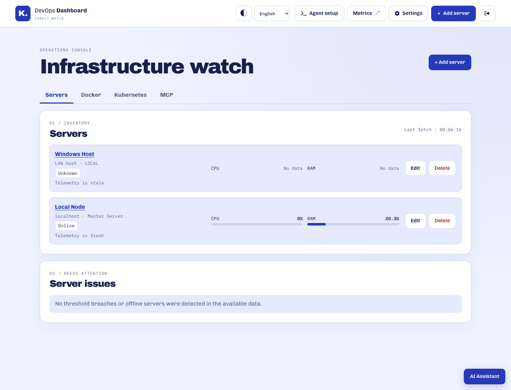 | 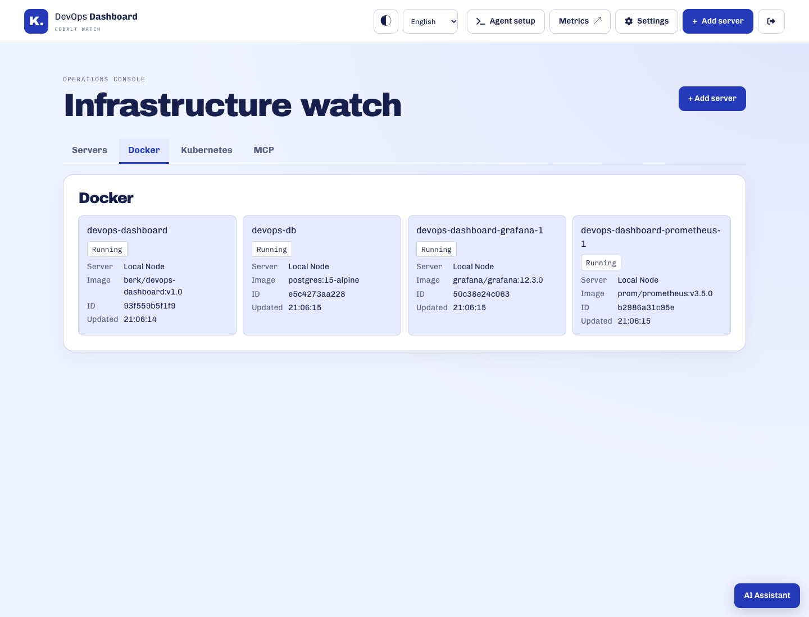 |

| Kubernetes pods | MCP tools |
|---|---|
| 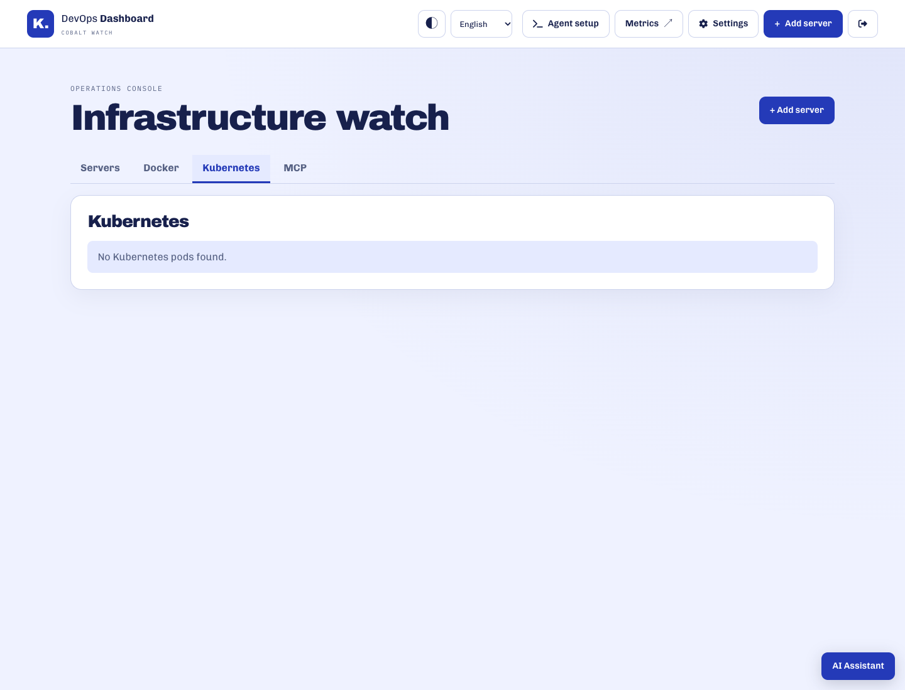 | 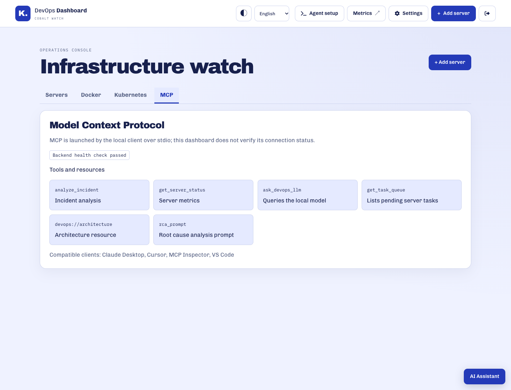 |

| Server details and telemetry | Server-aware AI chat |
|---|---|
| 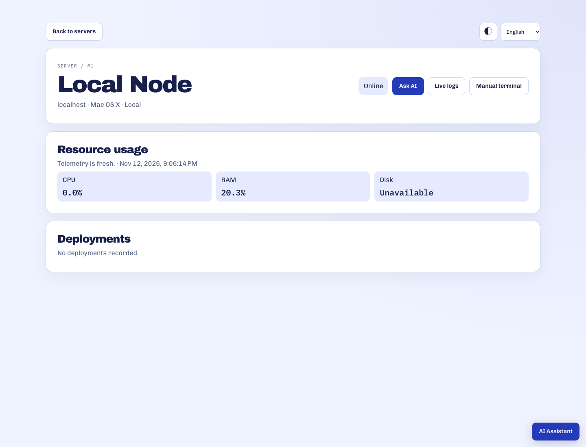 | 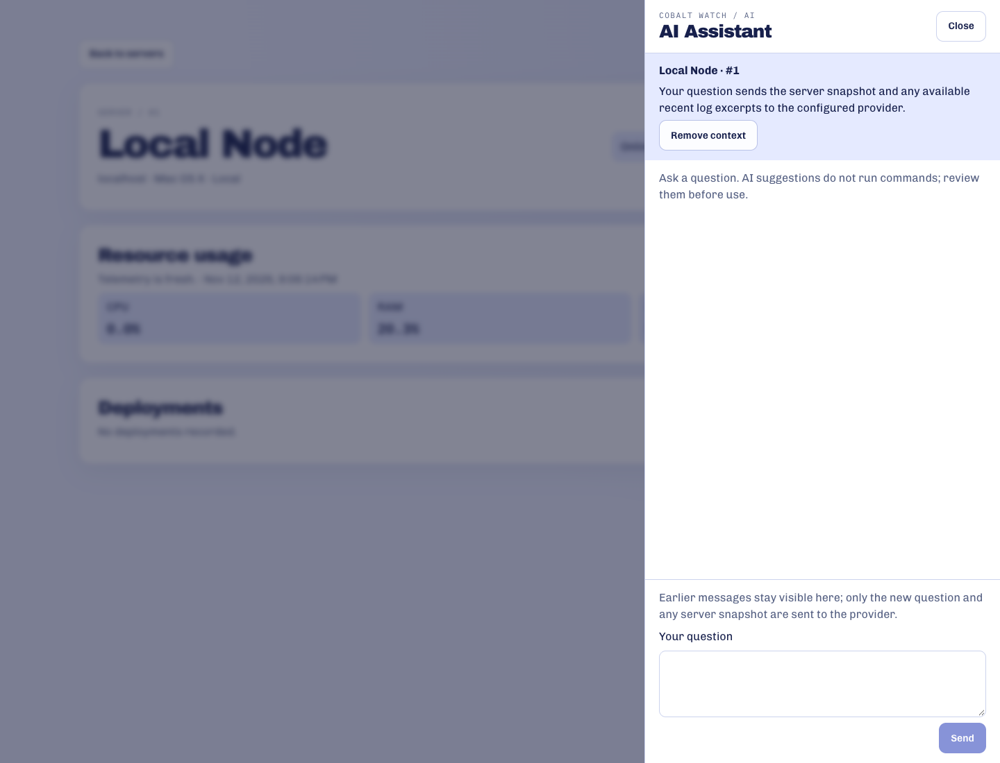 |

| Configuration settings | Prometheus target health |
|---|---|
| 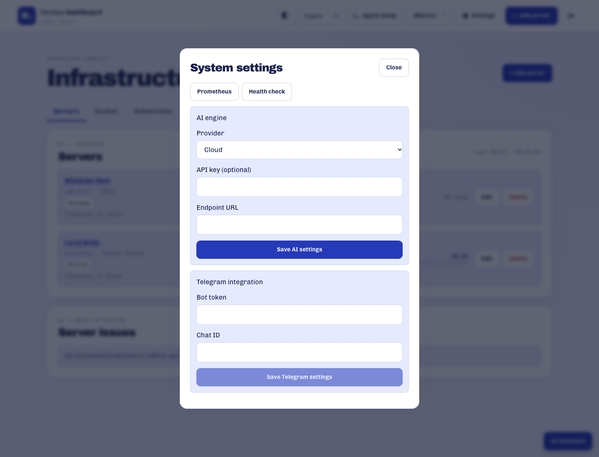 |  |

### AI Providers

Choose a provider in dashboard settings: `LOCAL` for an OpenAI-compatible local model endpoint such as LM Studio or Ollama; `CLOUD` for the configured cloud provider, which may require an API key; or `CREW_AI` for complexity-routed analysis through the Python AI service. Configure model endpoints and credentials through environment variables or the UI as appropriate. Never commit real API keys. Using a local model endpoint does not guarantee every application request stays local.

Run the CrewAI service separately:

```bash
cd ai-service
python3 -m venv .venv
source .venv/bin/activate
pip install -r requirements.txt
python app.py
```

### Prometheus Metrics

The dashboard exposes metrics at `http://localhost:15000/actuator/prometheus`. The optional Compose monitoring profile provisions Prometheus and a Grafana dashboard. Example metrics include `devops_server_cpu_usage`, `devops_server_ram_usage`, `devops_server_disk_usage`, `devops_server_container_count`, `devops_server_pod_count`, `devops_server_status`, and `devops_dashboard_online_count`.

### Security

Before production use, replace the Compose database password, restrict service exposure to trusted networks or a reverse proxy, and configure TLS and authentication. The default configuration is not a production-ready internet-facing security profile. Review remote agent scripts before running them; Docker socket access grants substantial privileges.

## Tech Stack

| Component | Technology |
|---|---|
| Frontend | Angular, TypeScript |
| Backend | Java 17+, Spring Boot |
| Database | PostgreSQL |
| AI service | Python, FastAPI, LangGraph, CrewAI |
| Monitoring | Micrometer, Prometheus, Grafana |
| Tool integration | Model Context Protocol (MCP) |
